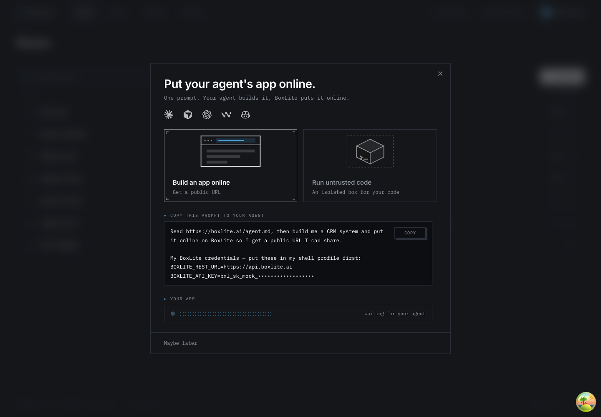
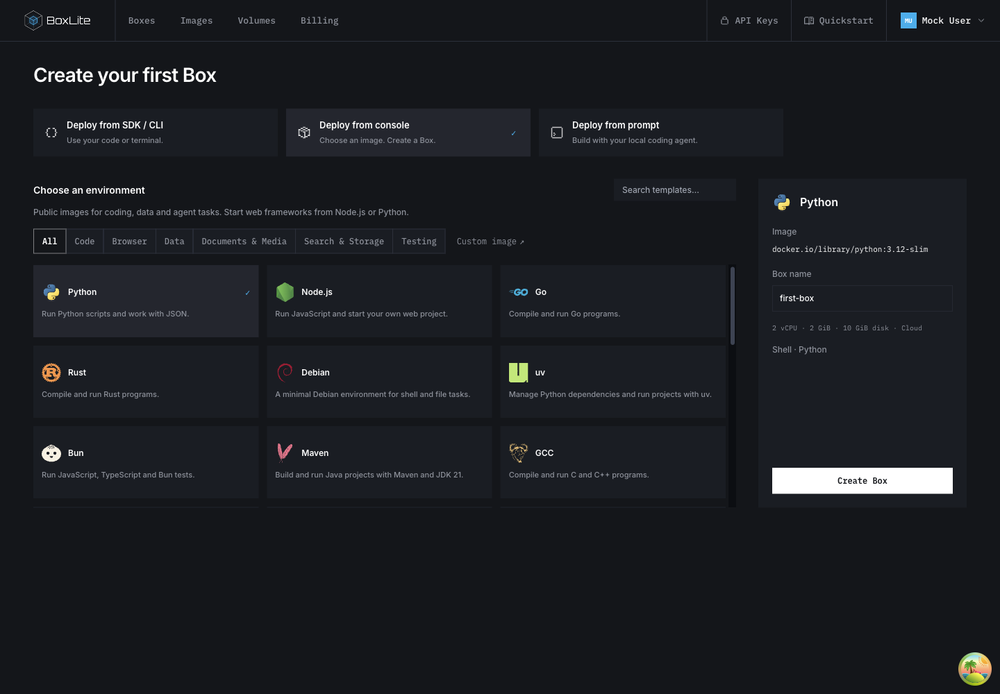

# New-user onboarding

## Design

New accounts should name their organization, state their use case, and reach one
Quickstart page with SDK/CLI, public image templates, and local-agent prompt paths.
Answers and prompt drafts belong to the backend; credit delivery is confirmed independently.

Scope: welcome, Quickstart, image templates, terminal auto-connect and persistence.
Keep the existing empty Boxes page and main's network/authentication behavior. Exclude
Billing restyling, Apps prototypes, first-run simulation, and fake terminal output.

Related work: the existing OrganizationController name endpoint owns organization updates;
OrganizationActionGuard owns membership/owner checks. Reuse both. The signup-credit pending
query on main uses bounded backoff against coupon/register; reuse the delivery contract,
not a timer as proof. Existing Quickstart examples own SDK execution; render their actual
programs in steps instead of maintaining separate snippets. Existing handoff credentials
remain in client memory, while only user-authored request text is persisted.

Use a dedicated page rather than retaining two competing modal/page onboarding flows.
Draft revisions prevent out-of-order autosaves; request IDs deduplicate handoff snapshots.
A copied prompt is not evidence of successful deployment. Existing organizations without
answers are not globally redirected; only the existing first-run entry invokes welcome.

Validation: type checks, targeted component/API tests, real PostgreSQL migration/concurrency
checks, production build and UI walkthrough. Document observed results before publication.

## User flow and deployment

1. A new account names its organization using the existing organization-name endpoint.
2. Choose a use case and optionally describe it. Continue saves this answer on the organization, then polls signup-credit delivery with bounded backoff. Failures remain visible and can be retried.
3. Quickstart offers SDK/CLI, console templates, or a prompt for a local coding agent. Console creation uses the selected public image, resource defaults and startup command. Existing Boxes empty-state content remains unchanged.
4. Prompt text autosaves after one second and on blur, scoped to the organization and user. Refresh restores saved text. Copy first saves a handoff snapshot; credentials are added only in the browser, never persisted in the snapshot. Copied status does not mean an application was deployed.

Apply the additive API migration before releasing the dashboard. The organization use case and per-user draft endpoints must be deployed together with this UI. See [API persistence contract](../api/src/organization/ONBOARDING.md) for authorization, validation, revision conflicts and retention.

Public templates share their catalog with Images. Template rows are not removable from the catalog; user-imported images retain their existing lifecycle. Public registry availability and runner architecture can change; this PR does not guarantee every future upstream tag remains available.

## UI comparison

These screenshots use local development fixtures, not a production account. The walkthrough covered organization name, long-running-agent intent, credit confirmation, switching all three methods, and saving/restoring prompt text after refresh.

Before: the existing modal combines the initial choice and agent handoff.

After: open Quickstart, choose Deploy from console, select Python, then Create Box.

After: choose Deploy from prompt, enter a request, wait for Saved, refresh, and return to the prompt path to restore it.

## Verification boundaries

Targeted dashboard tests cover routing, credit backoff, template rows, generated code steps, organization-save errors, and prompt autosave/revision behavior. API tests cover validation, authorization, idempotency and revision conflicts. Migration tests run against a disposable PostgreSQL database supplied through `ONBOARDING_TEST_DATABASE_URL` and create/drop their own schema. Frontend and API TypeScript checks and the dashboard production build passed locally.

The browser walkthrough used MSW fixtures. The integrated signup flow has not been deployed or accepted against the production API; complete that check after migration and backend deployment. Terminal auto-connect is included as a behavior change; a full-revert regression demonstration was not run for it.

The dashboard CI suite also checks the shared typography and square-corner design rules. Onboarding uses the named type-scale tokens. Interaction tests exercise name/intent submission, save retries, template creation and deployment-method switching; canvas tests cover reduced motion, viewport suspension and cleanup. Regenerate both cloud API clients whenever the onboarding DTOs or controller change, using the repository's pinned OpenAPI generator.
