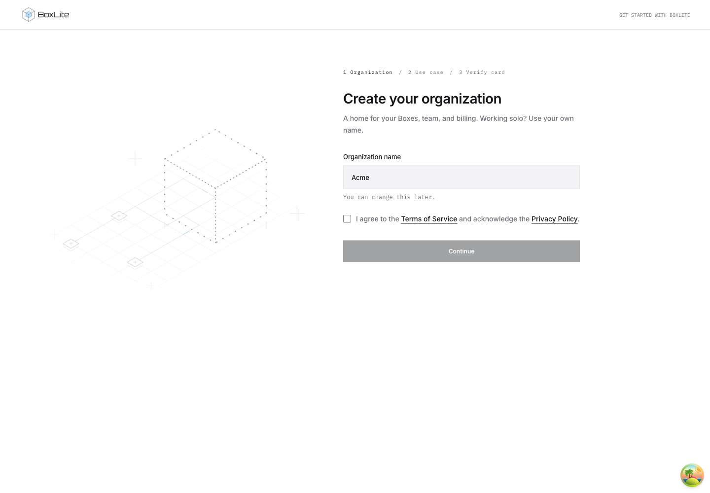
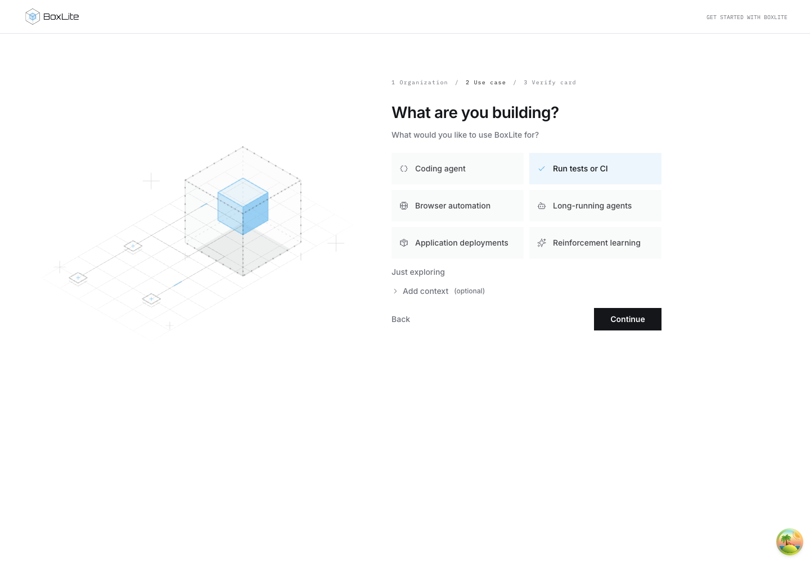
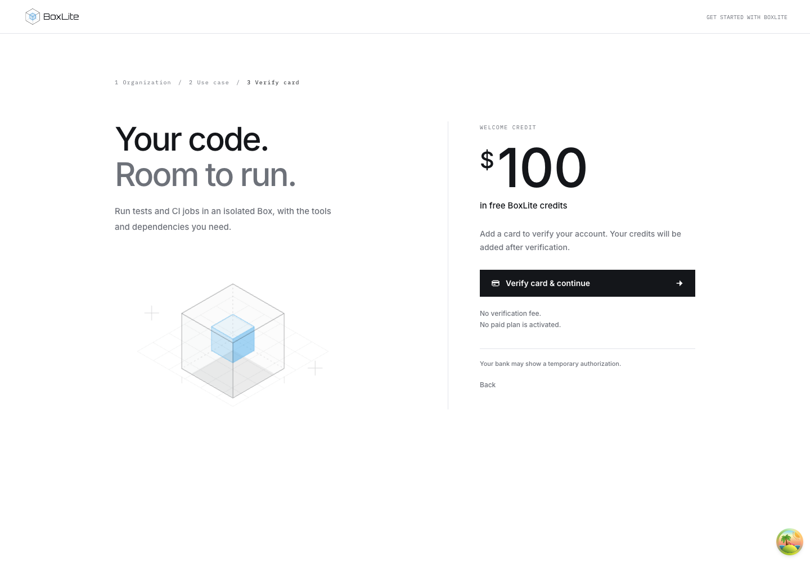
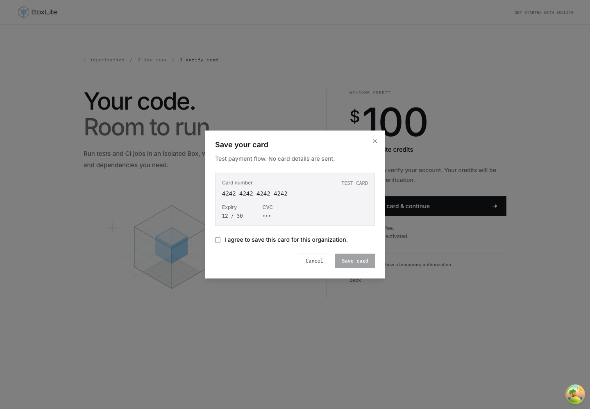
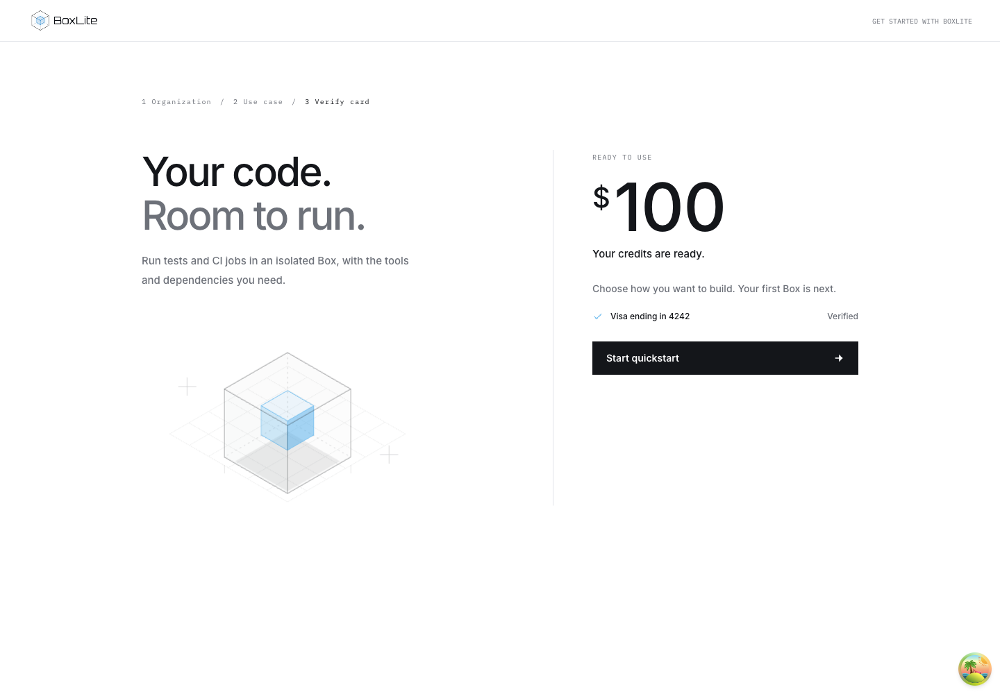

# Onboarding journey and screenshots

The welcome flow collects an organization name, explicit acceptance of the current
Terms of Service, and a use case. The development preview adds card verification
before credit delivery, with one animated Box connecting all three steps.

These screenshots use local development fixtures. Card verification and credit
delivery are simulated. No payment or cloud resource creation was performed for
these captures.

## Implementation boundaries

| Area | Implementation |
| --- | --- |
| Organization name and terms | Authenticated API, owner authorization, transactional PostgreSQL persistence, versioned acceptance and generated TypeScript/Go clients. Apply the migration before deploying this Console. |
| Use case | Existing organization onboarding persistence; “Run tests or CI” keeps the `code-execution` identifier. |
| Card verification and credits | Development preview only. Real Stripe verification, eligibility enforcement and credit delivery remain backend integration work. |

The card preview requires development mode and `VITE_ENABLE_MOCKING=true`.
Quickstart retains its three existing entries: SDK/CLI, console and prompt.
Organization terms acceptance is implemented outside the preview gate. See
[onboarding behavior](../../ONBOARDING.md) and the
[API persistence contract](../../../api/src/organization/ONBOARDING.md).

## Local preview

Start the mock Console using the [dashboard development instructions](../../README.md).
Open `/dashboard/welcome?preview=card-verification` for registration. The mock API
and base API URLs must both use the same `/api` origin.

Before enabling mandatory card verification in production, align the published
[Terms of Service](https://boxlite.ai/legal/terms), which currently describe signup
credits without requiring a payment card, with the intended eligibility policy.

## Organization and agreements

Continue requires a name and explicit confirmation. Official terms and privacy
links open separate tabs. The backend saves name and acceptance atomically; a
failed submission preserves the form. The illustration is positioned on initial
mount and persists across welcome steps.

## Use case

The use case is saved for the organization. Additional context is optional, and
the form supports returning to the organization step.

## Card verification

The preview explains the credit offer and requires verification before continuing.
Its animated Box shares geometry with the earlier welcome illustrations.

## Card consent

Saving a card requires a separate confirmation. This local dialog uses a fixed
test card and does not collect payment details.

## Credit delivery

The preview distinguishes card verification from credit delivery. Quickstart is
available after simulated delivery completes. Retry, ineligible-card and
delayed-credit states are also included.

## Verification

Validated on 2026-11-02:

- Dashboard test target: 89 files, 637 tests passed. The card-step assertion waits
  for the lazy component to render, rather than assuming a fixed loading duration.
- Controller, DTO and PostgreSQL migration suites: 28 tests passed, including
  concurrent acceptance, user isolation, stale versions, rollback and migration reuse.
- Dashboard and generated TypeScript client type checks passed. API type checking
  passed with `--preserveSymlinks` for the local linked dependency installation.
- Generated Go client tests passed. OpenAPI adds two endpoints and two schemas;
  existing paths and schemas remain unchanged.
- All five screenshots were captured from the running Console and inspected.
  Backend persistence was tested separately against disposable PostgreSQL 17.

These checks do not establish production payment verification or credit delivery.
